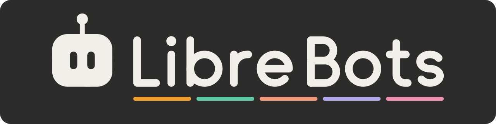
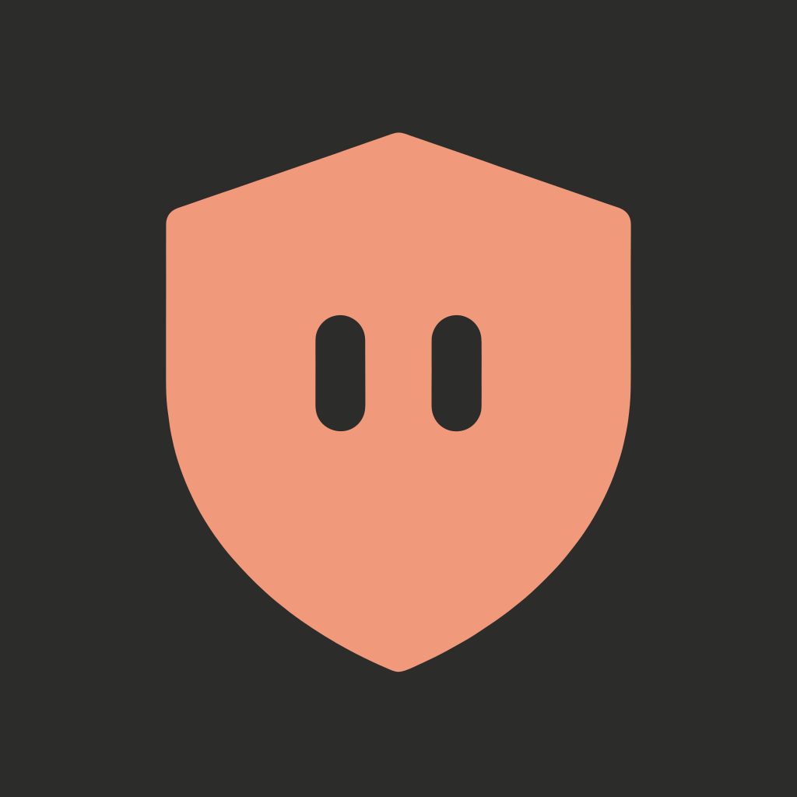

Open-source Discord bots, built with [hikari](https://github.com/hikari-py/hikari).

Libre Bots rebuilds the bots most servers end up installing: a starboard, tickets, moderation, giveaways. Add the hosted bots to your server, or run your own copy if you prefer. Either way the code is open, so you can see exactly what a bot does.

Each bot is also meant to be read. If you are learning hikari, every bot here is a complete, working project rather than a snippet.

## Bots

| | Bot | What it does | Status |
|---|---|---|---|
|  | **LibreStarboard** | Collects messages that get enough star reactions in one channel. | Planned |
|  | **LibreTickets** | Private support tickets, opened with one click. | Planned |
|  | **LibreModeration** | Warnings, timeouts, bans and a log of every action. | Planned |
|  | **LibreGiveaways** | Timed giveaways with randomly drawn winners. | Planned |

The project is just getting started. A bot moves from Planned to Available once you can add it to your server.

## How the bots are built

- **One bot, one job.** Add only the ones you need.
- **Open source.** You can read what a bot does before you add it.
- **Hosted or self-hosted.** Use the official bot, or run it on your own machine.
- **Named after what they do.** Libre plus the function, nothing to look up.
